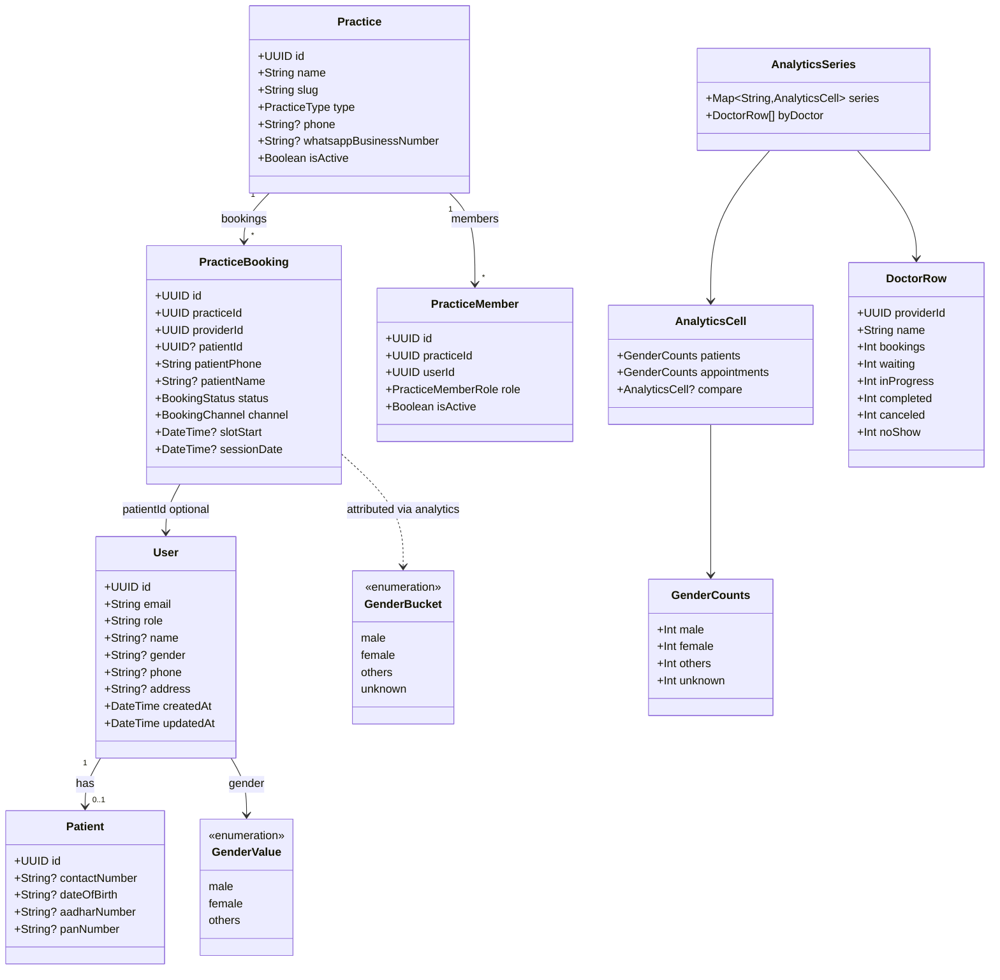
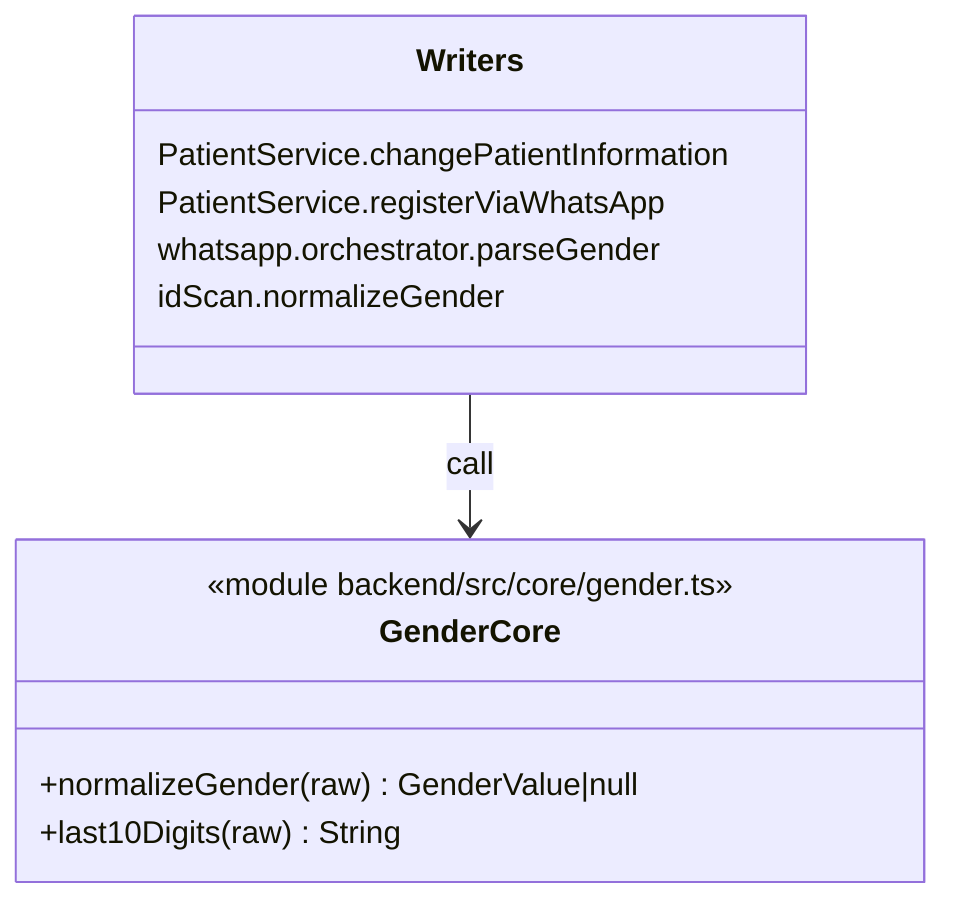
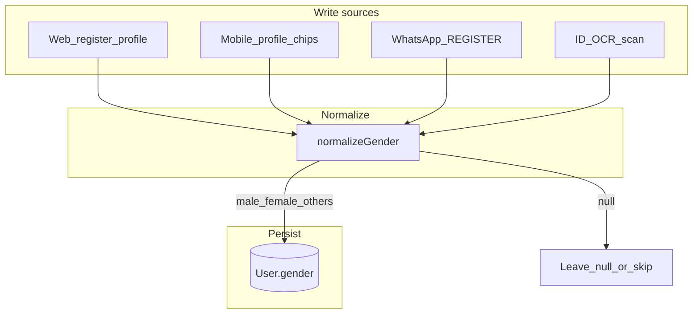
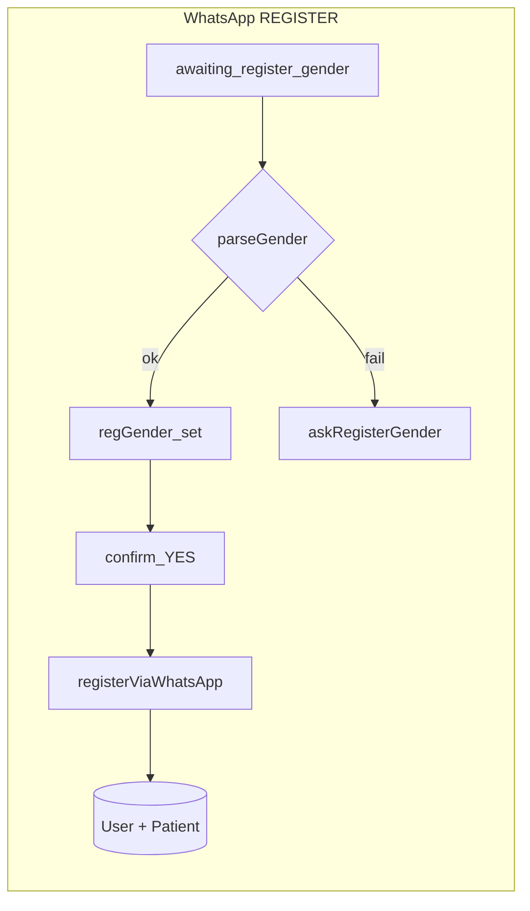
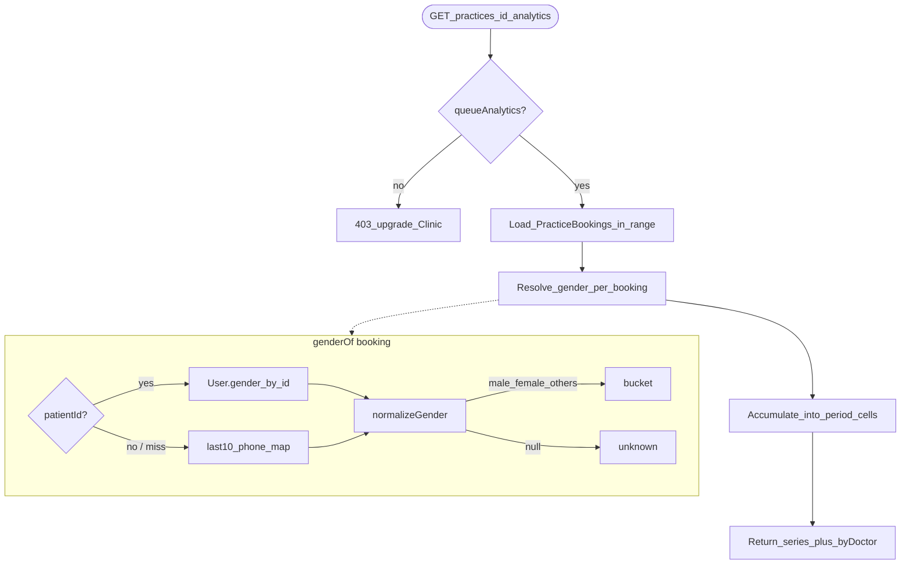
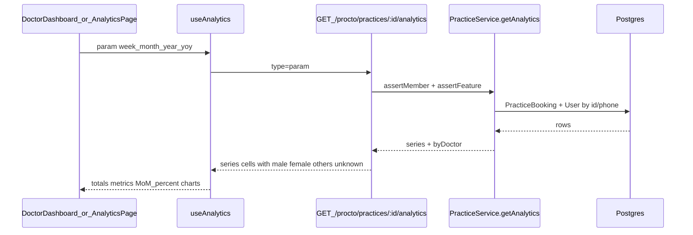
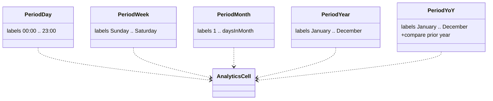

# Gender & Practice Analytics — Flows + Classes

**Audience:** engineering, QA  
**Related:** [flow.md](./flow.md) § analytics / WhatsApp register · Canonical values: `male` | `female` | `others` (null → `unknown` in charts)

This document describes how patient gender is written, normalized, attributed onto bookings, and rolled into Clinic-plan analytics — with UML-style classes (attributes) and flowcharts.

---

## 1. Domain class diagram (attributes)



### Attribute notes

| Class | Key attributes | Notes |
|-------|----------------|-------|
| `User.gender` | `String?` | Stored as `male` / `female` / `others` only after `normalizeGender()`. |
| `Patient.contactNumber` | `String?` | Used with `User.phone` for last-10 phone join when `patientId` is null. |
| `PracticeBooking.patientPhone` | required | WhatsApp / guest bookings may omit `patientId`. |
| `AnalyticsCell` | period label key | Labels: hour (`00:00`), weekday, day-of-month, or month name (`September`). |
| `GenderBucket.unknown` | chart only | Null / unnormalized gender — never written to `User.gender`. |

---

## 2. Normalization helper (shared)



**`normalizeGender` inputs → outputs**

| Input examples | Output |
|----------------|--------|
| `m`, `male`, `पुरुष` | `male` |
| `f`, `female`, `महिला` | `female` |
| `o`, `other`, `others`, `अन्य` | `others` |
| empty / garbage | `null` |

---

## 3. Gender write flow





---

## 4. Analytics attribution flow

Clinic plan feature flag: `queueAnalytics` (`PracticeService.getAnalytics`).



### Phone join rule

```text
booking.patientPhone  → last10Digits → Map key
User.phone            → last10Digits → Map key
Patient.contactNumber → last10Digits → Map key

Prefer: patientId → User.gender
Fallback: genderByPhone.get(last10(booking.patientPhone))
```

### Cell accumulation

For each period bucket:

1. `appointments[bucket] += 1` per booking.
2. `patients[bucket] += 1` once per distinct last-10 phone in that gender bucket.

YoY adds the same shape under `compare` for the prior year.

---

## 5. API → UI sequence



### Frontend totals / MoM

| UI surface | Period fetch | Totals | MoM % |
|------------|--------------|--------|-------|
| Dashboard cards | `year` | Current month name cell | Adjacent months in year series |
| Charts strip / analytics page | Selected period | Sum of all cells | MoM only when series is year-shaped |
| Provider app | day / week / month | Sum of all cells | N/A (bars only) |

---

## 6. Period bucket classes (logical)



---

## 7. File map

| Layer | Path |
|-------|------|
| Gender util | `backend/src/core/gender.ts` |
| Analytics | `backend/src/services/procto/practice.service.ts` → `getAnalytics` |
| WA gender | `backend/src/services/procto/whatsapp.orchestrator.ts` |
| Patient write | `backend/src/services/patient.ts` |
| Hook | `frontend/hooks/useAnalysis.ts` |
| Charts | `frontend/components/charts/DoctorCharts.tsx` |
| Dashboard cards | `frontend/components/ui/doctors/dashboard/Analytics.tsx` |
| Mobile chips | `apps/mobile/app/(app)/profile.tsx` |
| Provider bars | `apps/provider/app/(app)/analytics.tsx` |

---

## 8. Invariants (QA)

1. `User.gender` is only `male` | `female` | `others` | `null` after any write path.
2. Analytics never drops bookings: unattributed gender → `unknown`.
3. `+91XXXXXXXXXX` and `XXXXXXXXXX` resolve to the same gender when a matching user exists.
4. Year totals equal the sum of twelve month cells (not “current month only”).
5. Dashboard MoM uses year series month labels (`October`, not typos).
